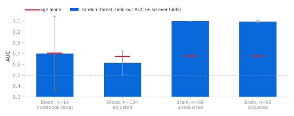

# hd-modifier-forest

A random forest for Huntington's disease on public GEO cohorts, and what it
took to make its AUC mean something.

<picture>
  <source media="(prefers-color-scheme: dark)" srcset="docs/auc_dark.svg">
  
</picture>

<sub>Held-out AUC from nested cross-validation (bars, ± sd over 25 outer folds) against a model that only knows each person's age (red). In blood, the forest never clearly beats age. In prefrontal cortex it's near perfect, and stays there after age, RNA quality and post-mortem interval are removed inside every training fold.</sub>

This continues my research with **Dr. Asha Pillai** (01/26 – 05/26). The
model is the one from our notebook: median imputation, a variance filter,
`SelectKBest(f_classif)` and a class-balanced `RandomForestClassifier`, tuned
with `GridSearchCV`. Its AUC wasn't good. This repo is about why, and what
changed.

## What was wrong

**Three of the four datasets never loaded.** The notebook read expression
from each GEO sample's own data table. That's where microarray values live,
but GEO keeps RNA-seq expression in series-level supplementary files, so
GSE51799, GSE64810 and GSE159940 came back empty and were skipped. The model
trained on the one microarray study: **14 people.**

**On 14 people, the split decides the score.** The notebook scored one 70/30
split, so 4–5 test samples. Rerunning that split with 20 different seeds
gives AUCs from **0.00 to 0.83**.

**Even loaded, one file would have been mislabelled.** GSE51799's matrix
names its columns `Sample 1 … Sample 124`, with no IDs. Matched in GEO
accession order, XIST (expressed only in females) correlates with recorded
sex at r = 0.01. In sample-title order it's r = 0.97, so title order is the
real one. [`test_data.py`](test_data.py) keeps that check.

**Age was doing the classifying.** In every cohort, HD and control groups
differ in age by 8–10 years. A logistic regression on age alone reaches
AUC 0.67–0.70, and the original model never got clear of it.

## What changed

1. **Read the RNA-seq cohorts** from their supplementary files
   ([`hdrf/data.py`](hdrf/data.py)). That takes the data from 14 samples to
   207: 138 blood and 69 brain.
2. **Nested cross-validation**: 5 folds × 5 repeats outside, with the grid
   search inside, so tuning never sees the samples it's scored on. The
   notebook tuned and scored on the same folds.
3. **Remove covariates inside each training fold**
   ([`Residualize`](hdrf/model.py)). Age, sex and reticulocyte fraction for
   blood; age, RIN and post-mortem interval for brain. Every result is
   reported next to age alone.
4. **Model the tissue where the disease is.** HD is a disease of the brain,
   and whole blood carries little of it. The primary model is now prefrontal
   cortex (GSE64810), with blood kept as a transfer test.
5. **Define a modifier gene properly.** A genetic modifier shifts *when*
   symptoms start beyond what CAG length predicts. Raw CAG correlation
   doesn't test that. The top genes are now also tested against **residual
   age of onset**: onset after removing the CAG-predicted part.

## Results

`python3 run.py` downloads the data (~75 MB) and writes
[`docs/results.md`](docs/results.md).

| Setup | n | Held-out AUC | Age alone |
| :-- | --: | --: | --: |
| Blood, GSE24250 only (the notebook's data) | 14 | 0.700 ± 0.346 | 0.704 |
| Blood, GSE51799, adjusted for age/sex/Hb% | 124 | 0.615 ± 0.109 | 0.674 |
| Brain BA9, GSE64810, unadjusted | 69 | 1.000 ± 0.000 | 0.682 |
| **Brain BA9, GSE64810, adjusted for age/RIN/PMI** | 69 | **0.996 ± 0.009** | 0.682 |

**Blood stays hard, and the README won't pretend otherwise.** I tried
restricting features to genes HD changes in the brain, scoring gene sets
instead of single genes, blood cell-type composition, and H2AFY (the marker
GSE24250's own paper proposed, at AUC 0.49 in GSE51799). Nothing passes age
alone. Whole-blood transcriptomes carry a weak HD signal at best, and these
are the numbers.

**Brain is clean, and the genes make sense.** The adjusted forest keeps most
of its top 20 genes in all 25 folds. 16 of them are developmental
transcription factors, all raised in HD: 14 homeobox genes (ten HOX genes
plus PITX1, POU4F2, OTP and SHOX2) and HAND1 and HAND2. That matches the original GSE64810 study (Labadorf et al., *PLOS ONE*
2015), which reported broad increases in developmental and inflammatory gene
expression in HD prefrontal cortex. The inflammatory side shows up too:
IL1R2, S100A9 and FKBP5.

**The modifier tests come back empty, and that's a result.** In the 20 HD
brains, CAG length predicts onset strongly (ρ = −0.87). None of the top 20
genes tracks CAG or residual onset after correction (all q > 0.8). With 20
people that's a power problem, not proof of absence. The forest's genes mark
*having* HD, and finding what shifts its timing will take a cohort with
hundreds of onset ages.

**Brain genes don't carry into blood.** Only 5 of the 20 are measured in
GSE51799. Scored with their brain direction, they reach AUC 0.571.

One caveat on the brain result: GEO doesn't record which brain bank each
sample came from, so a site effect that lines up with diagnosis can't be
ruled out from this data alone. Agreeing with the published biology is
reassuring, but it isn't the same as an independent cohort.

## Layout

```
hdrf/data.py     GEO download + parsing for GSE24250, GSE51799, GSE64810
hdrf/model.py    the notebook's pipeline, Residualize, nested CV
run.py           every number above
make_figure.py   redraws the chart from docs/results.md
test_data.py     sample wiring checks (XIST vs sex, label counts, CAG)
```

GSE159940 is left out on purpose: it's HD-only, so it can't train a
classifier, and its counts are genomic bins rather than genes.

```bash
pip install -r requirements.txt
python3 run.py          # ~10 min
python3 test_data.py
```
